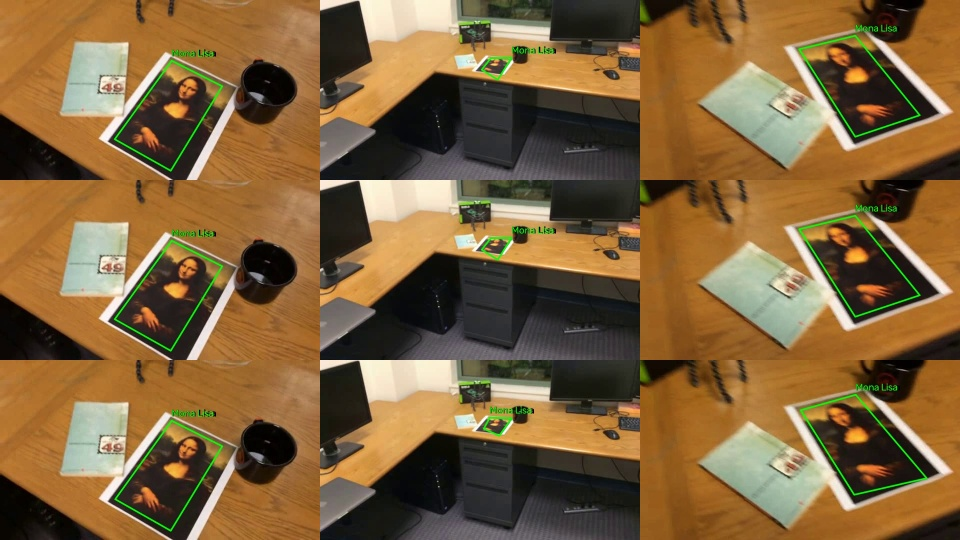

# Лабораторная работа № 2. Трекинг плоского объекта

Цель — отслеживать текстурированный плоский объект по ключевым точкам и рисовать перспективную рамку с подписью. Задание: [LW2_25.md](LW2_25.md). Реализация на Python с OpenCV и NumPy. Первым кадром задаётся эталон: объект должен занимать весь кадр. Рамка соответствует области этого эталона, а не внешним полям бумажного листа, которых в первом кадре нет.

## 1. Теоретическая база

**SIFT** находит локальные особенности изображения в пространстве масштабов и описывает окрестности точек векторами градиентных признаков. Нормализация масштаба и ориентации помогает сопоставлять объект при изменении размера и повороте. Для каждого дескриптора эталона ищутся два ближайших дескриптора кадра по евклидову расстоянию. Совпадение принимается при `d1 < 0.75 * d2`; неоднозначные пары отбрасываются. [Описание SIFT в OpenCV](https://docs.opencv.org/4.x/da/df5/tutorial_py_sift_intro.html).

Для плоского объекта изменение положения описывается гомографией: `s · [x', y', 1]ᵀ = H · [x, y, 1]ᵀ`, где `H` — матрица 3×3 с восемью независимыми параметрами. Теоретически достаточно четырёх пар точек в невырожденной конфигурации. В реализации требуется не менее десяти согласованных пар. RANSAC оценивает преобразование, отбрасывая выбросы; затем преобразуются четыре угла эталона. Получается четырёхугольник, учитывающий перспективу. [Сопоставление признаков и гомография](https://docs.opencv.org/4.x/d1/de0/tutorial_py_feature_homography.html).

**Пирамидальный метод Лукаса—Канаде** переносит ключевые точки между соседними кадрами, опираясь на приближённое постоянство яркости и локальную согласованность движения. Пирамида изображений позволяет обрабатывать более крупные перемещения. Перенос проверяется в обе стороны: точка должна вернуться к исходной позиции с ошибкой менее одного пикселя. Это помогает продолжать трекинг, когда прямых совпадений SIFT мало. [Оптический поток в OpenCV](https://docs.opencv.org/4.x/d4/dee/tutorial_optical_flow.html).

### Как вычисляется SIFT

SIFT сначала ищет устойчивые ключевые точки, а затем описывает окружение каждой из них:

1. **Пространство масштабов.** Изображение несколько раз размывается гауссовым фильтром с разными значениями σ. Затем оно уменьшается, и процесс повторяется. Так формируется пирамида, в которой можно обнаружить детали разных размеров.
2. **Кандидаты в точки.** Из соседних уровней размытия вычисляются разности гауссианов (DoG). Значение каждой точки сравнивается с 8 соседями на том же уровне и 18 соседями на двух соседних уровнях. Локальные максимумы и минимумы становятся кандидатами.
3. **Отбор.** Положение и масштаб кандидатов уточняются; точки со слабым контрастом и нестабильные точки на краях отбрасываются.
4. **Ориентация.** В окрестности точки вычисляются величины и направления градиентов яркости. По гистограмме направлений выбирается основная ориентация; при нескольких сильных пиках могут создаваться точки с разными ориентациями. Это помогает сопоставлению при повороте.
5. **Дескриптор.** Окрестность с учётом масштаба и ориентации разбивается на сетку 4×4. Для каждой ячейки строится гистограмма из 8 направлений градиента. Полученные 4×4×8 = 128 значений образуют нормализованный дескриптор, менее чувствительный к изменению освещения.

В данной работе SIFT отдельно запускается для первого кадра в масштабах 1, 1/2 и 1/4. Каждый запуск при этом строит собственное пространство масштабов. Дополнительные уменьшенные эталоны помогают при потере мелких деталей у удалённого объекта. Координаты точек делятся на масштаб: например, точка (100, 50) на изображении масштаба 1/2 соответствует (200, 100) на исходном эталоне. Дескрипторы всех трёх запусков объединяются.

### Сопоставление дескрипторов

`BFMatcher` сравнивает каждый дескриптор эталона с дескрипторами текущего кадра по евклидову расстоянию и выбирает двух ближайших кандидатов. Ratio test оставляет пару, если расстояние до лучшего кандидата `d1` меньше `0.75 * d2`, где `d2` — расстояние до второго. Например, 100 и 200 проходят проверку, а 100 и 110 — нет: во втором случае выбор слишком неоднозначен. Если несколько точек эталона выбрали одну точку кадра, сохраняется пара с наименьшим расстоянием.

### Гомография и RANSAC

Гомография переводит координаты точек плоского эталона в координаты текущего кадра, учитывая перспективу. После умножения `[x, y, 1]ᵀ` на `H` первые две компоненты делятся на третью, чтобы получить `(x', y')`. Применение этого преобразования к четырём углам эталона даёт рамку объекта.

Среди сопоставлений могут быть ошибки, поэтому используется RANSAC. Он многократно выбирает небольшие подмножества пар, оценивает по ним гомографию и проверяет остальные пары. Точки, которые модель переносит достаточно близко к найденным положениям на кадре, называются inliers; остальные считаются выбросами. В этой работе порог ошибки составляет 3 пикселя. Например, если из 40 пар 32 согласуются с моделью, их доля равна 80%; затем модель должна пройти и остальные проверки числа и распределения точек и геометрии рамки, перечисленные ниже.

Ошибка репроекции — расстояние между точкой кадра и положением, полученным преобразованием соответствующей точки эталона. В результат записывается медиана этой ошибки по inliers. Она характеризует согласованность точек с моделью, но сама по себе не измеряет точность границ объекта.

**Пример преобразования.** Для простоты возьмём гомографию с уменьшением вдвое и сдвигом на (100, 50): `H = [[0.5, 0, 100], [0, 0.5, 50], [0, 0, 1]]`. Точка эталона `(200, 100)` после умножения даёт `[200, 100, 1]ᵀ`, то есть точку кадра `(200, 100)`. Если найденная соответствующая точка кадра находится в `(202, 101)`, ошибка репроекции равна `√(2² + 1²) ≈ 2.24` пикселя — меньше порога 3. Такая пара согласуется с моделью. Для перспективного преобразования третья компонента может отличаться от 1, поэтому на неё необходимо разделить первые две. Аналогично преобразуются все четыре угла эталона, после чего полученная рамка проходит геометрические проверки.

### Углы Shi—Tomasi и оптический поток

Shi—Tomasi выбирает точки, вокруг которых яркость заметно меняется в двух направлениях. Для этого анализируются градиенты яркости в окрестности и минимальное собственное значение матрицы, составленной из их произведений. Углы подходят для отслеживания лучше, чем однородные области или точки на прямой границе: их положение легче определить в двух направлениях. После успешного SIFT такие точки выбираются внутри рамки, а их координаты сохраняются и в системе эталона, и в системе текущего кадра.

Если SIFT на следующем кадре не дал допустимого результата, пирамидальный метод Лукаса—Канаде ищет новые положения этих точек. Он предполагает приблизительное постоянство яркости и одинаковое движение в небольшой окрестности; смещение уточняется от уменьшенных уровней пирамиды к более детальным. Перенос выполняется вперёд и обратно, чтобы отсеять нестабильные точки. По сохранившимся парам «эталон — текущий кадр» снова оценивается гомография. При последовательном использовании потока ошибки могут накапливаться, поэтому на каждом кадре сначала снова пробуется прямое сопоставление с эталоном.

**Пример выбора точки и переноса.** Допустим, матрица градиентов Shi—Tomasi в одной окрестности имеет собственные значения 100 и 80, а в другой — 100 и 1. Минимальные значения равны 80 и 1 соответственно: первая точка лучше определена в обоих направлениях, вторая похожа на точку на краю. Реальный отбор также учитывает порог качества и минимальное расстояние между точками.

Пусть выбранная точка на предыдущем кадре находится в `(200, 120)`. Поток нашёл её в `(203, 122)` на новом кадре, а обратный перенос дал `(200.3, 120.4)`. Ошибка возврата равна `√(0.3² + 0.4²) = 0.5` пикселя. Она меньше 1, поэтому при успешных статусах переноса и положении внутри кадра точка сохраняется. Если после проверки осталось достаточно точек, их положения на эталоне и новом кадре используются для RANSAC и построения рамки.

## 2. Описание разработанной системы

| Файл | Назначение |
|---|---|
| `tracker.py` | Эталон, поиск соответствий, оптический поток, оценка и проверка гомографии, отрисовка |
| `main.py` | CLI, чтение и запись видео, CSV и JSON, контрольные кадры |
| `requirements.txt` | Зависимости для отдельного окружения |
| `results/` | Видео с рамками, контрольные изображения и фактические метрики |

Порядок обработки:

1. Первый кадр переводится в оттенки серого. SIFT вычисляется для масштабов 1, 1/2 и 1/4; координаты всех точек приводятся к исходному размеру. Уменьшенные эталоны помогают узнавать удалённый объект.
2. На очередном кадре находятся точки SIFT (до 2500, `contrastThreshold=0.025`). BFMatcher сопоставляет их с эталоном. После ratio test оставляется только одна пара для каждой точки текущего кадра.
3. По соответствиям оценивается гомография RANSAC: порог 3 пикселя, до 3000 итераций, доверительная вероятность 0.995.
4. Преобразование принимается при наличии не менее 10 inliers, их доле не менее 40% и покрытии выпуклой оболочкой исходных точек не менее 2% эталона. Проверяется конечность координат, отсутствие пересечения проективного горизонта, выпуклость и ориентация рамки, площадь от 100 пикселей до четырёх площадей кадра, пересечение с изображением не менее 100 пикселей.
5. После успешного SIFT внутри рамки выделяется до 250 разнесённых углов Shi—Tomasi. Их координаты переводятся в систему эталона обратной гомографией. Они используются для последующего оптического потока.
6. Если прямое сопоставление не прошло проверки, точки переносятся с предыдущего кадра методом Лукаса—Канаде (`winSize=21×21`, `maxLevel=3`). После проверки переноса туда и обратно снова оценивается гомография с теми же ограничениями.
7. При успехе рисуется зелёный четырёхугольник и подпись. При потере выводится `Object not found`, точки потока сбрасываются. На следующем кадре поиск по исходному эталону продолжается, что позволяет повторно обнаружить объект.

Первый кадр имеет статус `reference` и исключён из статистики обнаружений. CSV содержит номер и время кадра, статус, метод (`sift`/`flow`), количество соответствий, медианную ошибку репроекции, время обработки и координаты четырёх углов. Отсутствующие координаты записываются пустыми полями.

## 3. Результаты работы и тестирования

Использованы все три исходных видео: `mona-lisa.avi`, `mona-lisa-blur.avi`, `mona-lisa-blur-extra-credit.avi`. Каждый файл содержит 558 кадров 640×360 при 29.97 FPS; после исключения эталона оцениваются 557 кадров.

| Видео | Рамка принята | Доля | SIFT / поток | Потери | Скорость, кадр/с | Медиана ошибки репроекции, px |
|---|---:|---:|---:|---:|---:|---:|
| mona-lisa | 557/557 | 100.00% | 277 / 280 | 0 | 8.17 | 0.597 |
| mona-lisa-blur | 538/557 | 96.59% | 258 / 280 | 19 | 7.38 | 0.609 |
| mona-lisa-blur-extra-credit | 529/557 | 94.97% | 245 / 284 | 28 | 7.57 | 0.616 |
| document_5415727531443661930 | 280/280 | 100.00% | 255 / 25 | 0 | 4.31 | 0.606 |

Дополнительное видео `document_5415727531443661930.avi` содержит 281 кадр размером 720×1280 при 30 FPS; первый кадр использован как эталон. 

Контрольные кадры 100, 300 и 500 (слева направо); строки — обычное видео, blur, extra-credit. На кадре 300 заметно отклонение рамки при малом размере объекта.

## 4. Выводы по работе

Реализован трекинг плоского текстурированного объекта по ключевым точкам с перспективной рамкой. Прямое сопоставление с эталоном позволяет восстанавливать трек после потери, уменьшенные эталоны помогают при удалении камеры, а оптический поток продолжает трекинг при недостатке дескрипторных совпадений.

Ограничения: сильное размытие, перекрытие, малая видимая площадь и резкие движения могут приводить к потере. Длительная работа только по потоку накапливает дрейф, поэтому даже принятая рамка иногда отклоняется от границ. Геометрические проверки снижают число явно ошибочных рамок, но не гарантируют их точность. Метод предполагает плоский жёсткий объект и первый кадр, заполненный объектом; для произвольного первого кадра потребуется отдельное выделение эталона. Для количественной оценки качества границ следует разметить углы и измерить IoU либо ошибку углов.

## 5. Использованные источники

1. [Задание лабораторной работы](LW2_25.md).
2. [OpenCV: Introduction to SIFT](https://docs.opencv.org/4.x/da/df5/tutorial_py_sift_intro.html).
3. [OpenCV: Feature Matching + Homography to find Objects](https://docs.opencv.org/4.x/d1/de0/tutorial_py_feature_homography.html).
4. [OpenCV: Optical Flow](https://docs.opencv.org/4.x/d4/dee/tutorial_optical_flow.html).
