# Лабораторная работа 3. Сверхразрешение по маске с опорой на HR

SUPIR увеличивает кадр в четыре раза и в обычном режиме переписывает его целиком. Здесь цикл сэмплинга изменён: модель восстанавливает только фрагмент, отмеченный бинарной маской. Вне маски известен кадр в высоком качестве (HR). Он подставляется в латент на каждом шаге диффузии, а в конце вклеивается в результат.

**Цель работы** — выяснить, насколько знание HR вокруг восстанавливаемой области помогает модели по сравнению со случаем, когда у неё есть только испорченный вход (LR).

Задачи:

1. Изменить сэмплинг SUPIR так, чтобы восстанавливалась только область под маской, а вне маски на каждом шаге подставлялся зашумлённый латент HR.
2. Проверить три маски: все единицы (обычный SUPIR), все нули (выход равен HR) и комбинированную.
3. Восстановить одну и ту же область двумя способами, только по LR и по LR с HR-фрагментами вокруг, на изображениях DIV2K с четырьмя видами деградации. Четвёртая, сильная деградация `heavy` добавлена потому, что разница должна быть заметнее всего на сильно испорченном входе.
4. Оценить результаты метриками PSNR, LPIPS и CLIP-IQA.

## Запуск

Ноутбук рассчитан на Kaggle с двумя видеокартами T4 по 15 ГБ. На одной T4 SUPIR при рабочем разрешении 1024 в память не помещается.

1. Загрузить `LR3_SUPIR_SR_inpainting.ipynb` в Kaggle.
2. Settings → Accelerator: GPU T4 x2. Settings → Internet: On.
3. Run All.

Ноутбук сам ставит зависимости, клонирует [Fanghua-Yu/SUPIR](https://github.com/Fanghua-Yu/SUPIR), скачивает веса SDXL, `SUPIR-v0Q` и DIV2K valid. Весь прогон занял около 1 ч 40 мин, из них 10–15 минут — загрузка. Результат появляется в `/kaggle/working/results` и в архиве `results.zip`, раскладка та же, что у папки `results/` здесь.

Файлы:

- `LR3_SUPIR_SR_inpainting.ipynb` — весь код: данные и деградации, маски, загрузка SUPIR, семплер с маской, эксперимент, метрики, графики, абляция
- `requirements.txt` — зависимости, на Kaggle их ставит первая ячейка
- `results/metrics.csv` — метрики каждого прогона, `results/summary.csv` — средние по деградациям
- `results/hr/`, `results/lq/` — эталоны 512×512 и входы 128×128
- `results/outputs/` — выходы: `bicubic`, `ones` (только LR), `combined` (LR + HR)
- `results/grids/` — сравнения целиком, `results/zoom/` — крупные планы области маски
- `results/ablation/` — абляция: на скольких шагах опираться на HR

Параметры прогона: `SUPIR-v0Q`, 50 шагов EDM, CFG 7.5 с линейным расписанием от 4.0, `s_churn` 5, `restore_cfg` −1, `control_scale` 1, цветовая коррекция Wavelet, seed 1234. Это настройки режима Quality из демо SUPIR. Подписи LLaVA не считаются, промпт — стандартный положительный и отрицательный из демо. UNet в fp16 на `cuda:0`; VAE, текстовые энкодеры и метрики на `cuda:1`. Один прогон SUPIR — около 83 секунд.

## 1. Теоретическая база

Диффузионная модель учится убирать шум. На обучении к чистому изображению подмешивают гауссов шум разной силы, и сеть учится по зашумлённому кадру предсказать чистый. В формулировке EDM зашумлённое состояние при уровне шума σ — это чистый сигнал плюс шум, умноженный на σ. Генерация идёт в обратную сторону: от чистого шума при большом σ до σ = 0. Каждый шаг — это шаг численного решения уравнения, в SUPIR — методом Эйлера.

В латентной диффузии сеть работает не с пикселями, а с кодом изображения. Кодер VAE сжимает кадр в 8 раз по каждой стороне до четырёх каналов, декодер разворачивает код обратно. Кадр 1024×1024 превращается в латент 128×128. SDXL — латентная диффузия с UNet около 2.6 млрд параметров и двумя текстовыми энкодерами CLIP. Classifier-free guidance смешивает предсказания с промптом и без него и этим усиливает следование промпту.

SUPIR превращает SDXL в модель восстановления изображений. В нём три добавки.

- Деградационно-устойчивый кодер. Это дообученный кодер VAE: испорченный кадр он переводит в латент, близкий к латенту чистого.
- Адаптер. Копия кодирующей части UNet читает латент испорченного входа и через слои ZeroSFT подмешивает его признаки в декодер UNet. Так модель знает, что именно восстанавливать.
- Сэмплинг с притяжением к входу (restoration-guided sampling). В режиме по умолчанию он выключен (`restore_cfg` −1), так и оставлено.

Задача работы — SR-inpainting, сверхразрешение внутри маски. Маска — бинарный массив размера входа 128×128. Единица означает «этот участок восстанавливает диффузия по LR». Ноль означает «здесь известен HR». Так моделируется ситуация, когда часть кадра есть в хорошем качестве, а часть испорчена и её нужно восстановить.

Маска не подаётся в сеть отдельным каналом. Она вмешивается в сэмплинг по схеме RePaint и Blended Latent Diffusion. После каждого шага сеть предлагает новый латент. Вне маски это предложение выбрасывается, туда подставляется латент HR, зашумлённый ровно до текущего уровня:

$$x \leftarrow m \cdot x + (1 - m) \cdot (z_{HR} + \sigma \varepsilon)$$

Здесь m — маска в разрешении латента, z_HR — латент HR, ε — фиксированный шум. К последнему шагу σ = 0, и вне маски лежит ровно латент HR. Внутри маски остаётся то, что нарисовала сеть. Свёртки и self-attention UNet на каждом шаге видят настоящее окружение, поэтому модель продолжает внутрь маски реальные цвета, фактуры и контуры, а не только то, что удаётся угадать по LR.

Качество считается тремя метриками.

- PSNR сравнивает результат с эталоном попиксельно, по яркостному каналу Y. Выше — ближе к исходным числам. Гладкое увеличение часто выигрывает у генеративной модели: выдуманная деталь не совпадает с пикселями фотографии.
- LPIPS (AlexNet) тоже сравнивает с эталоном, но по признакам сети. Ниже — ближе по восприятию.
- CLIP-IQA эталон не использует. Модель CLIP оценивает, насколько кадр выглядит качественным. Выше — лучше.

Главное место сравнения — внутри маски. Снаружи у `combined` по построению стоит HR, и метрики по всему кадру завышали бы его качество.

## 2. Описание разработанной системы

Весь код — в одном ноутбуке. Семплер SUPIR (`RestoreEDMSampler`) унаследован, и в его цикл добавлено смешивание по маске. Сеть и веса не меняются.

На каждом кадре система делает шесть вещей.

1. Готовит пару: центральный кроп HR 512×512 из DIV2K valid и вход LR 128×128 одной из четырёх деградаций.
2. Увеличивает LR бикубикой до 1024×1024. Это вход SUPIR: на меньшем разрешении SDXL рисует повторяющиеся текстуры. HR тоже увеличивается до 1024 и кодируется в латент. Это известная картинка для нулей маски.
3. Растягивает маску 128×128 до латента 128×128 и расширяет её на 2 латентных пикселя. Так у диффузии остаётся запас, чтобы согласовать переход на границе.
4. Гоняет сэмплинг. После каждого шага Эйлера латент вне маски заменяется зашумлённым латентом HR.
5. Декодирует латент и применяет цветовую коррекцию Wavelet. Затем вклеивает результат в HR по маске с размытой границей (σ = 4 пикселя выходного разрешения). Это убирает даже потери VAE вне маски.
6. Уменьшает кадр до 512×512 и считает метрики против эталона.

Три маски, все в разрешении входа 128×128:

- `ones` — все единицы. Восстанавливается весь кадр, HR не используется: это обычный SUPIR, у модели есть только LR.
- `zeros` — все нули. Выход равен HR.
- `combined` — эллипс в центре, около трети площади. Внутри — восстановление по LR, снаружи — HR.

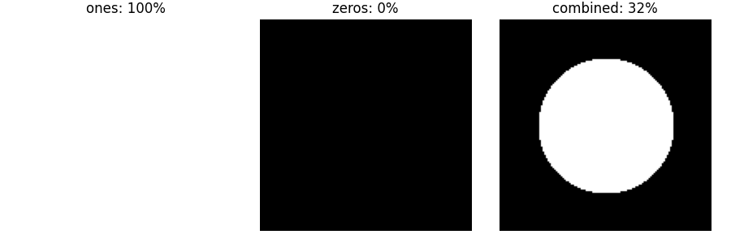

Четыре деградации:

- `bicubic` — официальный вход DIV2K x4, бикубическое уменьшение
- `unknown` — официальный вход DIV2K x4 с неизвестным ядром
- `realesrgan` — синтетическая деградация второго порядка по схеме Real-ESRGAN: размытие, ресайз, шум и JPEG, дважды
- `heavy` — сильная фиксированная порча: размытие σ = 2.5, уменьшение в 4 раза, шум σ = 20/255, JPEG качества 20

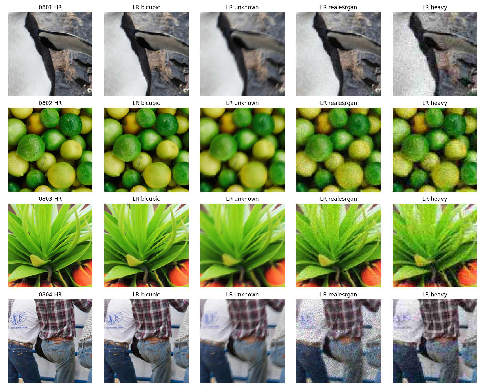

Для сравнения в таблицу добавлен бикубический апскейл LR ×4 без модели.

Правильность маски проверяется численно.

- При маске `ones` результат совпадает с исходным SUPIR: максимальная разница 2.4·10⁻⁷ в шкале [−1, 1]. Изменённый семплер без маски ведёт себя как оригинальный.
- При маске `zeros` выход совпадает с HR бит в бит на всех 16 парах.
- У `combined` средний PSNR вне эллипса — около 60 дБ. Отличия от HR есть только в хвосте размытой границы.

Системные требования: Python 3, CUDA, две видеокарты по 15 ГБ, около 20 ГБ ОЗУ при загрузке модели. Пиковая память: 8.1 ГБ на `cuda:0` и 6.4 ГБ на `cuda:1`.

## 3. Результаты работы и тестирования

Четыре кадра DIV2K valid: пингвин (0801), лаймы (0802), растение (0803), люди у ограждения (0804). На каждом — четыре деградации, бикубика и два способа восстановления. Вместе с абляцией — 64 прогона SUPIR. В таблице средние по четырём кадрам внутри маски. Полные числа лежат в `results/metrics.csv`.

| деградация | метод | PSNR, дБ | LPIPS | CLIP-IQA |
|---|---|---:|---:|---:|
| bicubic | бикубика | 30.75 | 0.350 | 0.561 |
| bicubic | только LR | 28.50 | 0.209 | 0.756 |
| bicubic | LR + HR | 30.04 | **0.162** | 0.756 |
| unknown | бикубика | 24.42 | 0.517 | 0.431 |
| unknown | только LR | 23.65 | 0.379 | 0.613 |
| unknown | LR + HR | 23.65 | **0.294** | **0.678** |
| realesrgan | бикубика | 26.82 | 0.572 | 0.463 |
| realesrgan | только LR | 27.00 | 0.408 | 0.579 |
| realesrgan | LR + HR | **27.05** | **0.268** | **0.728** |
| heavy | бикубика | 25.58 | 0.687 | 0.314 |
| heavy | только LR | 25.26 | 0.525 | 0.486 |
| heavy | LR + HR | **26.06** | **0.396** | **0.618** |

«Только LR» — маска `ones`, «LR + HR» — маска `combined`. CLIP-IQA считается по квадрату вокруг маски. У эталонных HR на том же квадрате она равна 0.793.

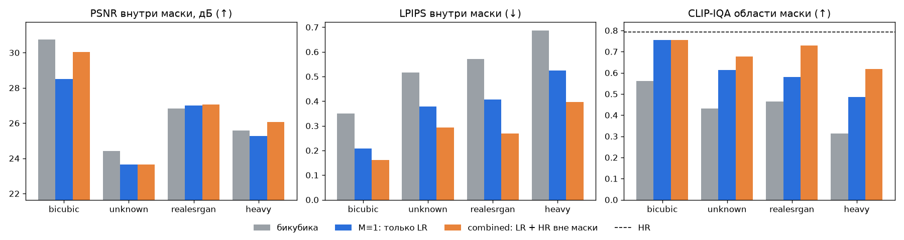

С HR вокруг LPIPS внутри маски ниже на всех четырёх деградациях. По отдельным кадрам — во всех 16 парах из 16. На чистом `bicubic` выигрыш маленький: LPIPS 0.209 → 0.162. На испорченных входах он в 2–3 раза больше: 0.085 на `unknown`, 0.139 на `realesrgan`, 0.129 на `heavy`. Чем меньше информации в самом LR, тем больше модель берёт из окружения.

На `heavy` разница видна и по PSNR. По одному LR SUPIR хуже бикубики: 25.26 против 25.58 дБ. С HR вокруг он её обходит: 26.06 дБ. Модель дорисовывает уже не произвольные детали, а продолжение настоящих. По кадрам так на трёх из четырёх, у людей (0804) PSNR остаётся на уровне бикубики.

На лаймах при `heavy` это видно глазами. По одному LR модель не узнаёт фрукты и рисует колючие плоды с шипами. С HR вокруг лаймы остаются гладкими лаймами, как на эталоне. LPIPS падает с 0.379 до 0.214.

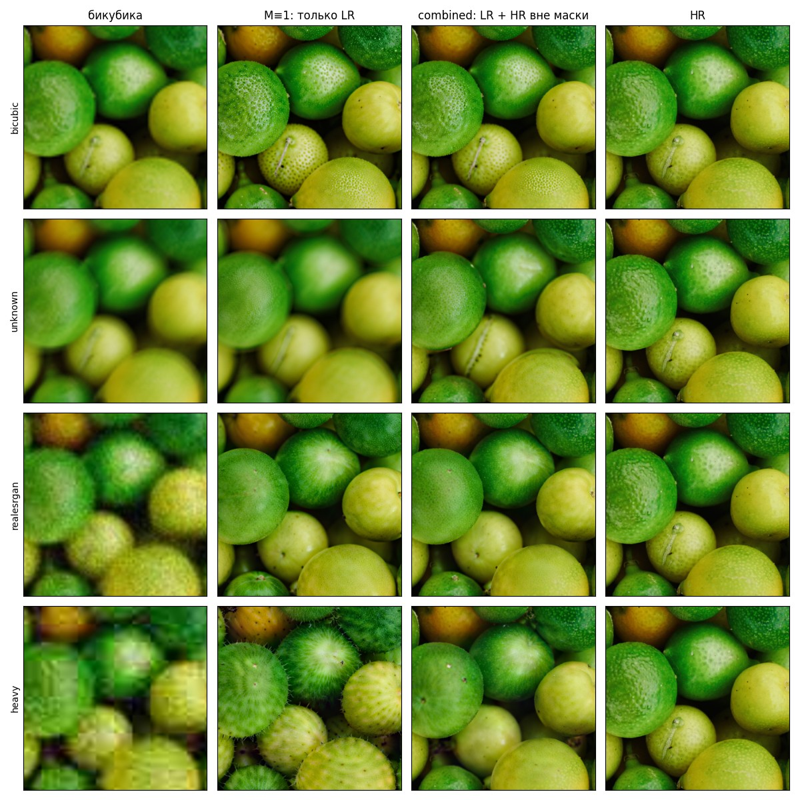

У людей при `realesrgan` по одному LR получается мыльное пятно. С HR вокруг появляются клетка рубашки, ремень и карманы джинсов. LPIPS 0.654 → 0.328. Детали правдоподобные, но это не копия эталона, а реконструкция.

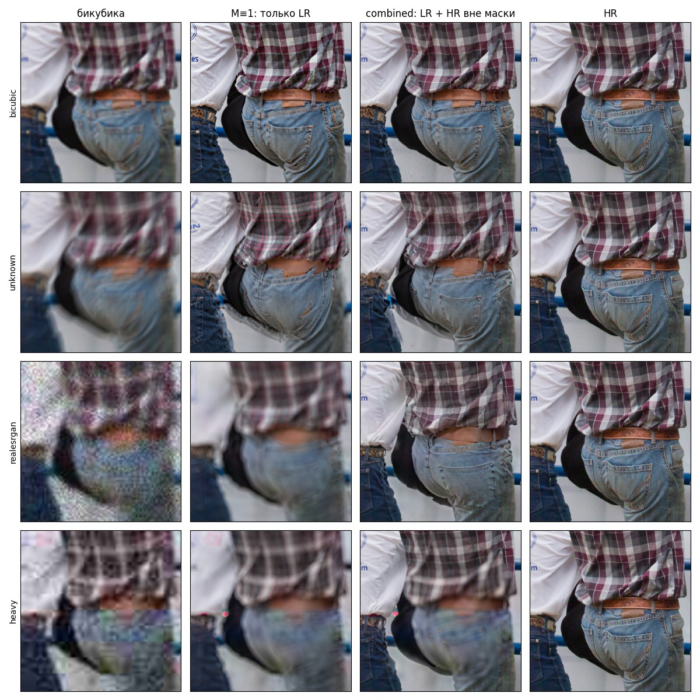

HR вокруг не спасает от галлюцинаций в глубине маски. У пингвина при `realesrgan` на фоне между крылом и телом модель рисует морду животного, и по одному LR, и с HR. С HR вокруг она даже отчётливее: нос и усы. Окружение задаёт цвет и продолжение контуров у границы. Содержимое в центре области модель по-прежнему угадывает по LR.

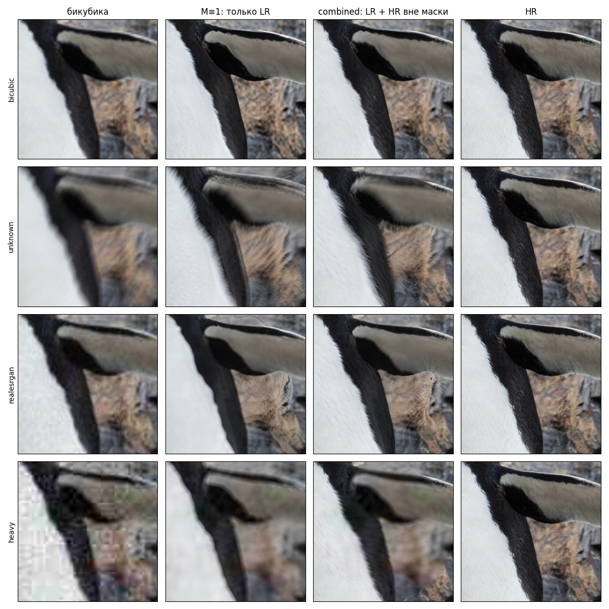

На растении при `heavy` с HR вокруг листья у края маски резкие и продолжают настоящие. К центру кадр остаётся размытым: там до известных пикселей далеко.

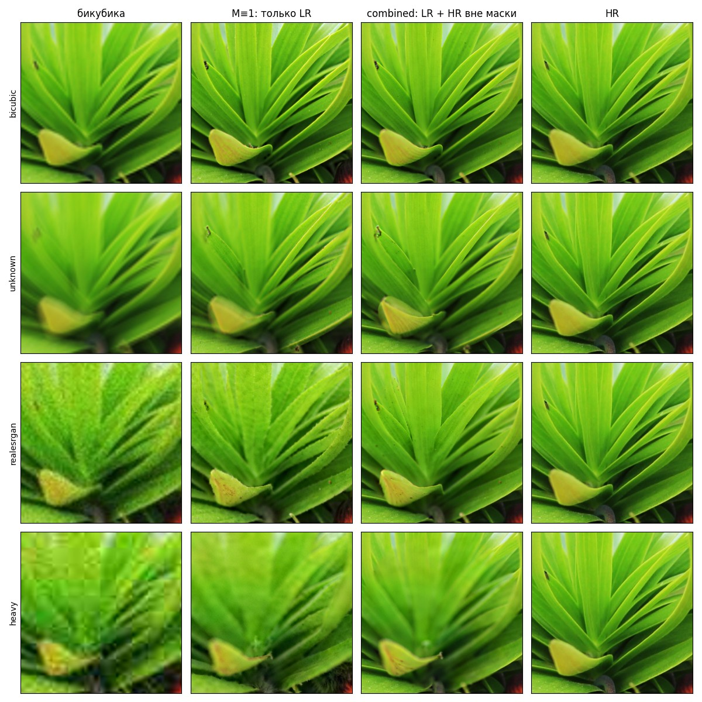

Кадры целиком, с контуром маски. Слева направо: LR, бикубика, только LR, LR + HR, эталон.

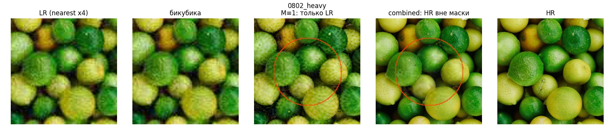

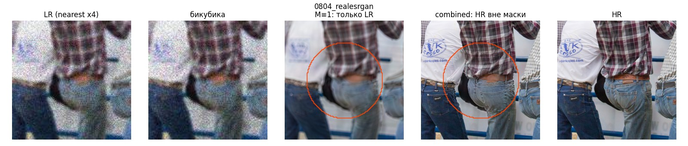

Остальные 14 сравнений лежат в `results/grids/`.

Отдельно о SUPIR против бикубики по всему кадру, маска `ones`. PSNR у SUPIR ниже на всех деградациях, кроме `realesrgan`: на 2.52 дБ на `bicubic`, на 0.36–0.82 дБ на остальных. LPIPS лучше на 0.13–0.20, CLIP-IQA выше на 0.12–0.25. Это компромисс искажения и восприятия: генеративная модель рисует правдоподобные детали, которые не совпадают с пикселями эталона.

Шов на границе маски мерится в полосе ±8 пикселей. У `combined` половина полосы — уже HR, поэтому числа там высокие, PSNR 28–35 дБ. На кадрах шов глазом не виден.

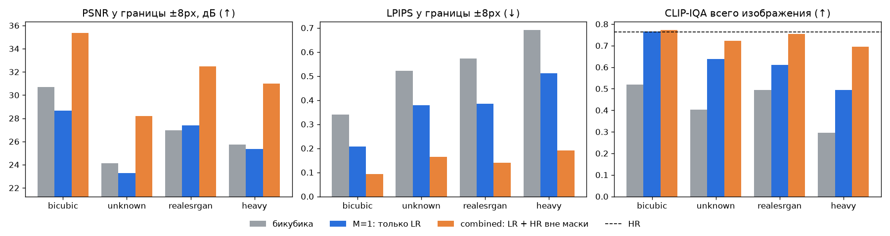

### Абляция: на скольких шагах опираться на HR

Маска `combined`, все 16 пар. Меняется доля шагов, на которых латент вне маски заменяется зашумлённым HR. После этой доли латент снаружи развивается свободно, но в конце HR всё равно вклеивается. «Вставка» — выход SUPIR по одному LR, вклеенный в HR по размытой маске. HR во время диффузии там не используется.

| доля шагов | LPIPS внутри | PSNR внутри, дБ | PSNR у границы, дБ |
|---|---:|---:|---:|
| 1.0 | **0.280** | 26.70 | **31.76** |
| 0.7 | 0.298 | **26.71** | 31.70 |
| 0.4 | 0.332 | 26.38 | 31.34 |
| вставка | 0.359 | 26.25 | 30.13 |

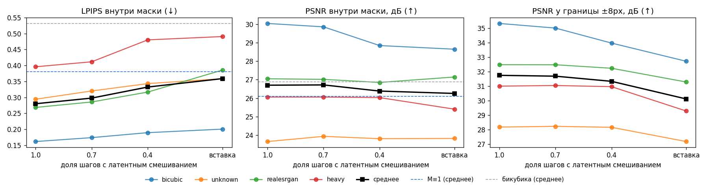

Чем дольше модель опирается на HR, тем лучше. Внутри маски LPIPS растёт от 0.280 до 0.359, у границы PSNR падает с 31.76 до 30.13 дБ. Ранние шаги задают крупную структуру, поздние — мелкие детали, и обе части выигрывают от настоящего окружения. Вставка хуже всех: детали, выдуманные без контекста, не стыкуются с HR. На лаймах при вставке внутри маски снова колючие плоды.

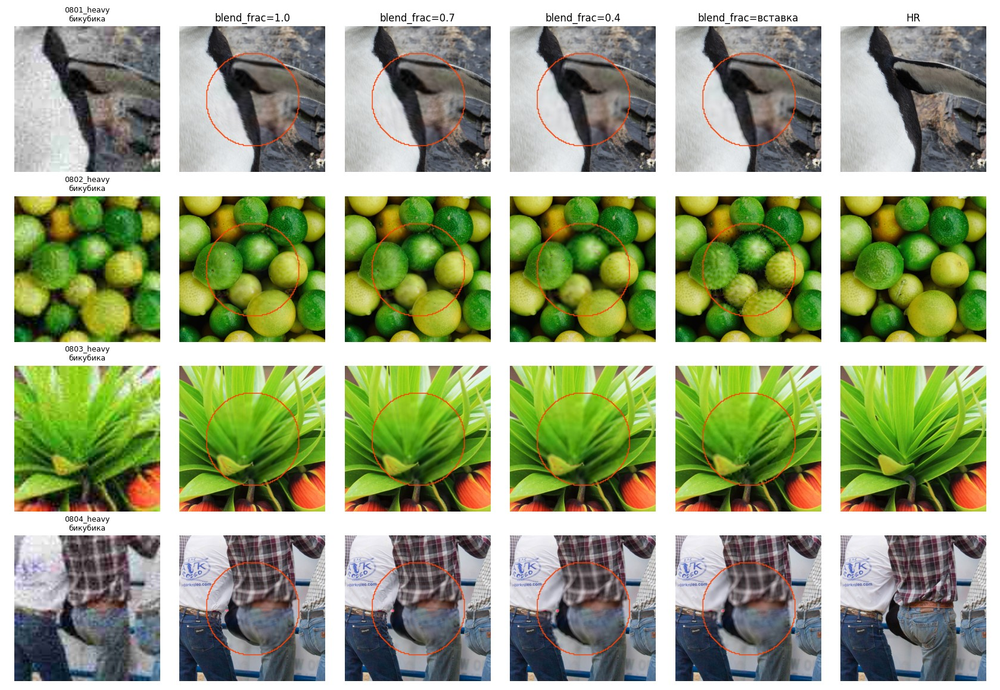

## 4. Выводы

Сэмплинг SUPIR можно ограничить маской, не дообучая сеть. На каждом шаге вне маски латент заменяется зашумлённым латентом HR, в конце HR вклеивается по маске. Нулевая маска даёт ровно HR, полная — обычный SUPIR, комбинированная восстанавливает только эллипс.

Опора на HR-фрагменты помогает восстановлению. Внутри маски LPIPS лучше во всех 16 парах, в среднем 0.380 → 0.280. Выигрыш тем больше, чем сильнее испорчен вход. На чистом бикубическом уменьшении LR и так содержит почти всё нужное. На `heavy` с HR вокруг SUPIR обходит бикубику даже по PSNR, хотя по одному LR ей проигрывает. Модель не просто вклеивает соседей: окружение влияет на сам процесс диффузии. Это показывает абляция: вставка готового результата хуже смешивания на всех шагах.

Контекст действует сильнее у границы, чем в глубине маски. Галлюцинации вдали от известных пикселей остаются: морда животного у пингвина появляется и с HR вокруг. Для большой маски одного смешивания латента мало. Можно подавать HR-фрагменты и в адаптер SUPIR или использовать повторное зашумление из RePaint.

Метрики снова расходятся. PSNR выше там, где модель ничего не выдумывает. LPIPS и CLIP-IQA выше там, где она добавляет резкость. CLIP-IQA эталона не знает и одобряет любую правдоподобную деталь, поэтому рядом с ней нужны PSNR и LPIPS.

## 5. Использованные источники

1. Yu F. et al. Scaling Up to Excellence: Practicing Model Scaling for Photo-Realistic Image Restoration In the Wild (SUPIR). CVPR 2024. Модель работы: деградационно-устойчивый кодер, адаптер, семплер EDM. Код: <https://github.com/Fanghua-Yu/SUPIR>
2. Podell D. et al. SDXL: Improving Latent Diffusion Models for High-Resolution Image Synthesis. 2023. Базовая модель SUPIR.
3. Rombach R. et al. High-Resolution Image Synthesis with Latent Diffusion Models. CVPR 2022. Диффузия в латентном коде VAE.
4. Karras T. et al. Elucidating the Design Space of Diffusion-Based Generative Models (EDM). NeurIPS 2022. Формулировка шума через σ и семплер Эйлера.
5. Lugmayr A. et al. RePaint: Inpainting using Denoising Diffusion Probabilistic Models. CVPR 2022. Подмена известной области зашумлённым исходником на каждом шаге.
6. Avrahami O. et al. Blended Latent Diffusion. SIGGRAPH 2023. То же смешивание по маске в латентном пространстве.
7. Zhang L. et al. Adding Conditional Control to Text-to-Image Diffusion Models (ControlNet). ICCV 2023. Схема адаптера, на которой основан адаптер SUPIR.
8. Wang X. et al. Real-ESRGAN: Training Real-World Blind Super-Resolution with Pure Synthetic Data. ICCVW 2021. Деградация второго порядка.
9. Agustsson E., Timofte R. NTIRE 2017 Challenge on Single Image Super-Resolution: Dataset and Study. CVPRW 2017. Набор DIV2K, дорожки bicubic и unknown.
10. Zhang R. et al. The Unreasonable Effectiveness of Deep Features as a Perceptual Metric. CVPR 2018. LPIPS.
11. Wang J., Chan K. C. K., Loy C. C. Exploring CLIP for Assessing the Look and Feel of Images. AAAI 2023. CLIP-IQA.
12. Chen C., Mo J. IQA-PyTorch (pyiqa). Реализация CLIP-IQA: <https://github.com/chaofengc/IQA-PyTorch>
13. Blau Y., Michaeli T. The Perception-Distortion Tradeoff. CVPR 2018. Почему PSNR и перцептивные метрики расходятся.
